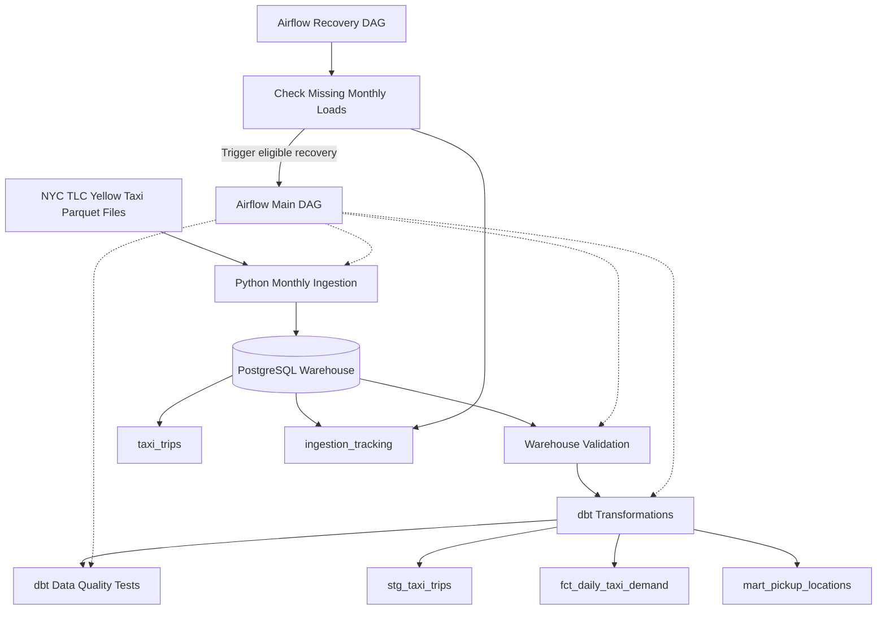
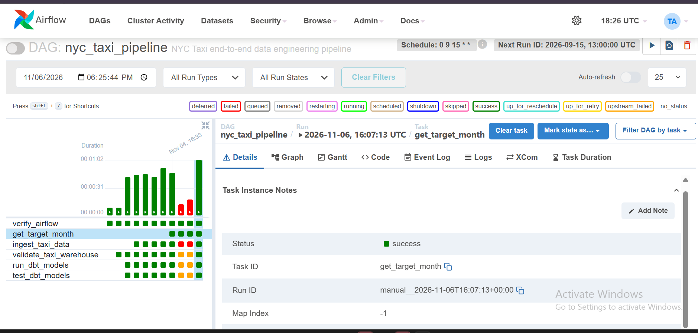
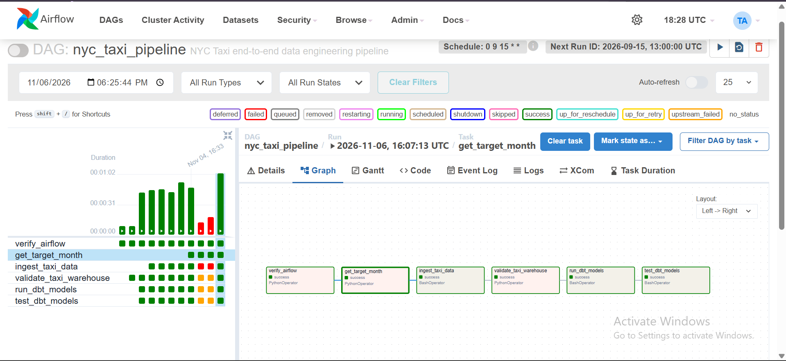
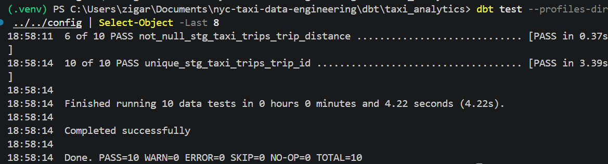

# NYC Taxi Data Engineering & Analytics Pipeline

An end-to-end data engineering project that ingests, validates, stores, and transforms New York City Yellow Taxi trip data using **Python, PostgreSQL, Apache Airflow, dbt, and Docker**.

This project demonstrates practical data engineering skills including ETL pipeline development, workflow orchestration, data warehousing, SQL transformations, automated data quality testing, and recovery workflow design.

## Project Overview

The pipeline processes publicly available NYC Yellow Taxi trip records and transforms raw transportation data into structured analytical datasets.

### Key Results

- **2,964,550 NYC Yellow Taxi records** ingested for January 2024.
- PostgreSQL 16 data warehouse deployed using Docker.
- Monthly data ingestion and processing workflow developed using Apache Airflow.
- Daily recovery workflow designed to identify missing monthly loads.
- **6 of 6 Airflow tasks successfully completed** in the November 6, 2026 pipeline run.
- Three dbt analytical models developed.
- **10 of 10 dbt data quality tests passed**, with zero warnings and errors.
- **5 Python integration tests passed.**
- Ingestion tracking implemented to monitor monthly data loading.

## Technology Stack

| Technology | Purpose |
|---|---|
| Python 3.12 | Data ingestion, processing, and validation |
| Pandas | Data manipulation |
| PyArrow | Parquet file processing |
| PostgreSQL 16 | Data warehousing |
| Apache Airflow 2.10.5 | Workflow orchestration |
| dbt | SQL transformations and data quality testing |
| Docker & Docker Compose | Containerized infrastructure |
| SQL | Analytical queries and data modeling |
| Git & GitHub | Version control |

## Pipeline Architecture



### Pipeline Components

**1. Data Source**

The pipeline uses publicly available NYC Taxi & Limousine Commission (TLC) Yellow Taxi trip data stored in Parquet format.

**2. Python Data Ingestion**

Python scripts process monthly taxi trip datasets and load records into PostgreSQL.

The ingestion layer supports data validation and tracking of loaded datasets.

**3. PostgreSQL Data Warehouse**

PostgreSQL stores the ingested trip data and ingestion metadata.

Primary tables:

- `public.taxi_trips`
- `public.ingestion_tracking`

**4. dbt Transformations**

dbt transforms warehouse data into reusable analytical models for taxi demand and pickup-location analysis.

**5. Data Quality Testing**

Python integration tests and dbt tests validate ingestion and transformation correctness.

**6. Apache Airflow Orchestration**

Airflow provides monthly pipeline execution and daily recovery workflow definitions.

## Data Warehouse

### Main Tables

| Table | Description |
|---|---|
| `public.taxi_trips` | Stores ingested NYC Yellow Taxi trip records |
| `public.ingestion_tracking` | Tracks monthly ingestion activity |

### Ingestion Results

| Metric | Result |
|---|---|
| Dataset | NYC Yellow Taxi |
| Period | January 2024 |
| Records ingested | 2,964,550 |
| Storage | PostgreSQL 16 |
| Source format | Parquet |

## dbt Analytics Models

The project includes three analytical models.

### 1. `stg_taxi_trips`

A staging model that prepares trip-level warehouse data for downstream analysis.

### 2. `fct_daily_taxi_demand`

A fact model designed to support daily taxi demand analysis.

### 3. `mart_pickup_locations`

An analytical model designed to support pickup-location analysis.

These models demonstrate SQL-based transformations and analytical data modeling.

## Apache Airflow Orchestration

The project contains two Airflow DAGs.

### Main Pipeline DAG

**File:** `dags/nyc_taxi_pipeline.py`

Defines the monthly ingestion, validation, and transformation workflow.

The main pipeline contains six tasks:

1. `verify_airflow`
2. `get_target_month`
3. `ingest_taxi_data`
4. `validate_taxi_warehouse`
5. `run_dbt_models`
6. `test_dbt_models`

### Recovery DAG

**File:** `dags/nyc_taxi_recovery.py`

Defines a daily workflow for checking missing monthly loads and coordinating recovery.

Both DAGs are currently paused to prevent unintended scheduled execution.

## Pipeline Execution Screenshots

### Airflow Execution History

The Airflow interface shows the execution history of the NYC Taxi pipeline, including successful pipeline runs.



### Successful End-to-End Pipeline Execution

On November 6, 2026, the Airflow pipeline completed all six tasks successfully.

The execution graph demonstrates the workflow from environment verification and monthly ingestion through PostgreSQL validation, dbt transformations, and data quality testing.



## Data Quality & Testing

The project includes automated tests to verify pipeline reliability and data integrity.

| Test Category | Result |
|---|---|
| dbt data quality tests | 10 passed |
| Python integration tests | 5 passed |
| Airflow main pipeline | 6 of 6 tasks successful in the selected run |

### dbt Test Execution Results

All **10 automated dbt data quality tests passed successfully**, with zero warnings and zero errors.

The tests validate key data quality constraints, including non-null values and uniqueness across staging and analytical models.

**Latest verified test execution:**

| Metric | Result |
|---|---|
| Tests executed | 10 |
| Tests passed | 10 |
| Warnings | 0 |
| Errors | 0 |
| Skipped | 0 |
| Execution time | 4.22 seconds |
| Status | Completed successfully |



### Python Integration Tests

The project also includes Python integration tests covering pipeline functionality.

**Result: 5 integration tests passed.**

## Project Structure

```text
nyc-taxi-data-engineering/
|
|-- dags/
|   |-- nyc_taxi_pipeline.py
|   |-- nyc_taxi_recovery.py
|
|-- dbt/
|   |-- taxi_analytics/
|       |-- models/
|
|-- config/
|   |-- profiles.yml
|
|-- screenshots/
|   |-- airflow_dags.png
|   |-- airflow_pipeline_success.png
|   |-- dbt_tests_passed.png
|
|-- Dockerfile.airflow
|-- README.md
|-- .gitignore
|
|-- Additional ingestion, testing,
|   and Docker configuration files
```

## Getting Started

### Prerequisites

- Python 3.12
- Docker and Docker Compose
- PostgreSQL
- Git

### 1. Clone the Repository

```bash
git clone https://github.com/GraciousRegina/nyc-taxi-data-engineering.git
cd nyc-taxi-data-engineering
```

### 2. Configure Environment Variables

Configure the environment variables required by the project's Docker, PostgreSQL, and Airflow services.

The dbt profile reads the following PostgreSQL settings:

- `POSTGRES_USER`
- `POSTGRES_PASSWORD`
- `POSTGRES_DB`

The database host and port can also be configured using:

- `POSTGRES_HOST`
- `POSTGRES_PORT`

For dbt running inside Docker, the database service is accessible through the Docker network.

For dbt running locally on Windows, use the PostgreSQL host port exposed by Docker Compose.

Do not commit credentials or `.env` files to GitHub.

### 3. Start the Infrastructure

Start the project's Docker Compose services:

```bash
docker compose up -d
```

### 4. Run the Pipeline

The project includes Python ingestion scripts and dbt transformations.

Airflow DAGs can be inspected through the Airflow web interface.

The DAGs are intentionally paused by default. Review configuration and dependencies before enabling scheduled execution.

### 5. Run dbt Tests

Navigate to the dbt project:

```bash
cd dbt/taxi_analytics
```

Ensure the required PostgreSQL environment variables are configured.

Run:

```bash
dbt debug --profiles-dir ../../config
dbt test --profiles-dir ../../config
```

The dbt profile uses the following host and port defaults when environment variables are not supplied:

- Host: `postgres`
- Port: `5432`

For the current Windows development setup, PostgreSQL is accessible at `127.0.0.1:5433`.

These values can be overridden using `POSTGRES_HOST` and `POSTGRES_PORT`.

## Engineering Highlights

### Data Ingestion

Processed nearly three million NYC Yellow Taxi records using Python and Parquet-based data processing.

### Data Warehousing

Implemented a PostgreSQL warehouse with ingestion tracking.

### Data Modeling

Built dbt staging and analytical models to support taxi demand and pickup-location analysis.

### Workflow Orchestration

Developed Airflow workflows for monthly processing and daily recovery checks.

### Data Quality

Validated the project with 10 successful dbt tests, 5 successful Python integration tests, and a fully successful six-task Airflow run.

### Containerization

Used Docker and Docker Compose to support a reproducible development environment.

## Future Improvements

- Add incremental ingestion for additional months.
- Expand historical taxi demand analysis.
- Introduce pipeline monitoring and alerting.
- Add an interactive analytics dashboard.
- Optimize large-scale data processing.
- Expand automated data quality checks.

## Data Source

NYC Taxi & Limousine Commission (TLC) Trip Record Data:

https://www.nyc.gov/site/tlc/about/tlc-trip-record-data.page

## Author

**Gracious Regina Zigara**

M.S. Data Science  
Stevens Institute of Technology

GitHub: https://github.com/GraciousRegina
