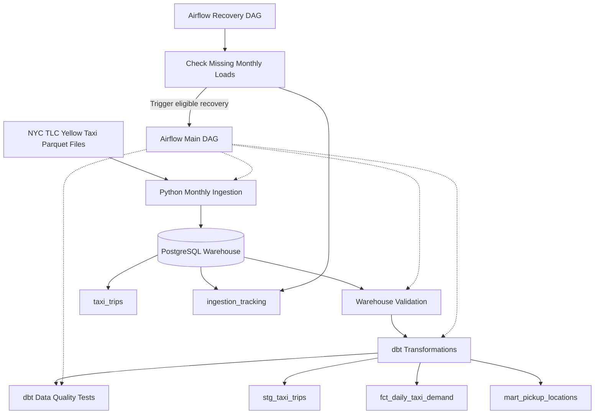

# NYC Taxi Data Engineering & Analytics Pipeline

An end-to-end data engineering project that ingests, validates, stores, and transforms New York City Yellow Taxi trip data using Python, PostgreSQL, Apache Airflow, dbt, and Docker.

The project demonstrates practical data engineering skills including ETL development, workflow orchestration, data warehousing, SQL transformations, data quality testing, and recovery pipeline design.

## Project Overview

This pipeline processes publicly available NYC Yellow Taxi trip records and transforms raw transportation data into structured analytical datasets.

### Key Results

- **2,964,550 taxi trip records** ingested for January 2024.
- PostgreSQL warehouse implemented using Docker.
- Automated monthly ingestion workflow designed with Apache Airflow.
- Daily recovery workflow designed to identify missing monthly loads.
- Three dbt analytics models developed.
- **10 dbt tests passed.**
- **5 Python integration tests passed.**
- Ingestion tracking implemented to monitor data loading.

## Technology Stack

| Technology | Purpose |
|---|---|
| Python 3.12 | Data ingestion, processing, and validation |
| Pandas | Data manipulation |
| PyArrow | Parquet file processing |
| PostgreSQL 16 | Data warehouse |
| Apache Airflow 2.10.5 | Workflow orchestration |
| dbt | SQL transformations and data quality testing |
| Docker & Docker Compose | Containerized infrastructure |
| SQL | Analytical queries and data modeling |
| Git & GitHub | Version control |

## Pipeline Architecture



### Pipeline Components

**1. Data Source**

The pipeline uses publicly available NYC Taxi & Limousine Commission Yellow Taxi trip data stored in Parquet format.

**2. Python Ingestion**

Python scripts process monthly taxi trip datasets and load records into PostgreSQL.

The ingestion layer supports data validation and tracking of loaded datasets.

**3. PostgreSQL Data Warehouse**

PostgreSQL stores the ingested trip data and ingestion metadata.

Primary tables:

- `public.taxi_trips`
- `public.ingestion_tracking`

**4. dbt Transformations**

dbt transforms warehouse data into reusable analytical models.

**5. Data Quality Testing**

Python integration tests and dbt tests help verify pipeline correctness and data integrity.

**6. Apache Airflow Orchestration**

Airflow provides workflow definitions for monthly pipeline execution and daily recovery checks.

## Data Warehouse

### Main Tables

| Table | Description |
|---|---|
| `public.taxi_trips` | Stores ingested NYC Yellow Taxi trip records |
| `public.ingestion_tracking` | Tracks monthly ingestion activity |

### Ingestion Results

| Metric | Result |
|---|---|
| Dataset | NYC Yellow Taxi |
| Period | January 2024 |
| Records ingested | 2,964,550 |
| Storage | PostgreSQL 16 |
| Source format | Parquet |

## dbt Analytics Models

The project includes three analytical models.

### 1. `stg_taxi_trips`

A staging model that prepares trip-level warehouse data for downstream analysis.

### 2. `fct_daily_taxi_demand`

A fact model designed to support daily taxi demand analysis.

### 3. `mart_pickup_locations`

An analytical model designed to support pickup-location analysis.

These models demonstrate SQL-based transformation and analytical data modeling.

## Apache Airflow Orchestration

The project contains two Airflow DAGs.

### Main Pipeline DAG

**File:** `dags/nyc_taxi_pipeline.py`

Defines the monthly ingestion, validation, and transformation workflow.

### Recovery DAG

**File:** `dags/nyc_taxi_recovery.py`

Defines a daily workflow for checking missing monthly loads and coordinating recovery.

The DAGs are currently paused to prevent unintended execution.

## Data Quality & Testing

The project includes automated tests for pipeline reliability.

| Test Category | Result |
|---|---|
| dbt tests | 10 passed |
| Python integration tests | 5 passed |

Testing helps validate the ingestion and transformation components.

## Project Structure

```text
nyc-taxi-data-engineering/
|
|-- dags/
|   |-- nyc_taxi_pipeline.py
|   |-- nyc_taxi_recovery.py
|
|-- dbt/
|   |-- taxi_analytics/
|       |-- models/
|
|-- config/
|   |-- profiles.yml
|
|-- Dockerfile.airflow
|-- README.md
|-- .gitignore
|
|-- Additional ingestion, testing,
|   and Docker configuration files
```

## Getting Started

### Prerequisites

- Python 3.12
- Docker and Docker Compose
- PostgreSQL
- Git

### 1. Clone the Repository

```bash
git clone https://github.com/GraciousRegina/nyc-taxi-data-engineering.git
cd nyc-taxi-data-engineering
```

### 2. Configure Environment Variables

Configure the environment variables required by the project's Docker, PostgreSQL, and Airflow services.

The dbt profile reads the PostgreSQL password from:

```text
POSTGRES_PASSWORD
```

Store credentials locally and do not commit secrets to GitHub.

### 3. Start the Infrastructure

Use the Docker Compose configuration included in the repository to start the required services.

For a standard Docker Compose setup:

```bash
docker compose up -d
```

### 4. Run the Pipeline

Use the ingestion scripts and dbt project included in the repository.

Airflow DAGs can be inspected through the Airflow web interface.

The DAGs are intentionally paused by default. Review configuration and dependencies before enabling scheduled execution.

### 5. Run Tests

Run the project's Python integration tests and dbt tests using the corresponding test commands and project configuration.

## Engineering Highlights

### Data Ingestion

Processed nearly three million NYC Yellow Taxi records using Python and Parquet-based data processing.

### Data Warehousing

Implemented a PostgreSQL warehouse with ingestion tracking.

### Data Modeling

Built dbt staging and analytical models to support taxi demand and pickup-location analysis.

### Workflow Orchestration

Developed Airflow workflows for scheduled processing and recovery checks.

### Data Quality

Validated the project with 10 successful dbt tests and 5 successful Python integration tests.

### Containerization

Used Docker to support a reproducible development environment.

## Future Improvements

- Add incremental ingestion for additional months.
- Expand historical taxi demand analysis.
- Introduce pipeline monitoring and alerting.
- Add a visualization dashboard.
- Optimize large-scale data processing.
- Expand automated data quality checks.

## Data Source

NYC Taxi & Limousine Commission (TLC) Trip Record Data:

https://www.nyc.gov/site/tlc/about/tlc-trip-record-data.page

## Author

**Gracious Regina Zigara**

M.S. Data Science  
Stevens Institute of Technology

GitHub: https://github.com/GraciousRegina
